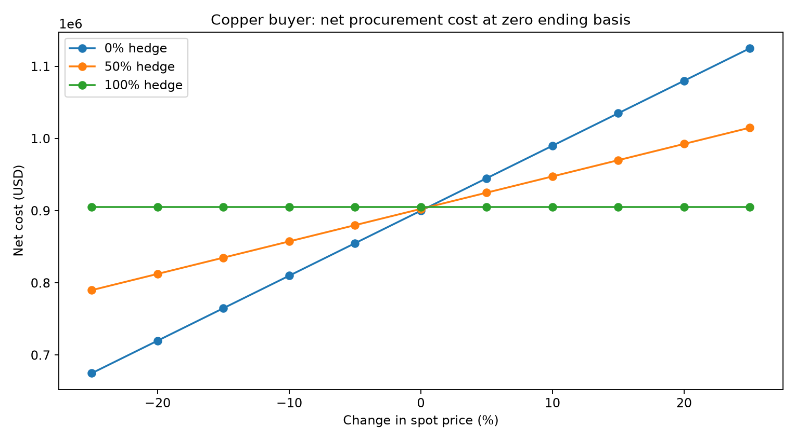

# Copper Procurement Hedging Scenario Explorer

Quantify how long futures hedges change a copper buyer's procurement cost under price and basis scenarios.



## Project provenance

Inspired by a copper-futures hedging proposal I contributed to during my commodities research internship. This repository is a new educational simulation; it uses no customer positions, employer reports or current market prices.

## Business or research question

Quantify how long futures hedges change a copper buyer's procurement cost under price and basis scenarios. The goal is to make assumptions and uncertainty visible rather than only produce a chart.

## Run locally

Requires Python 3.10 or later. From this repository folder:

```bash
python3 -m venv .venv
source .venv/bin/activate
python -m pip install -r requirements.txt
python main.py
python -m unittest discover -s tests -v
```

Windows: use `.venv\\Scripts\\activate` instead of the source command. No API key, account or network data request is used by the analysis. Package installation requires internet access. CSVs and PNGs in `outputs/` are already included so you can inspect the results without installing anything.

## Approach

1. Specify a 100-tonne future procurement exposure and illustrative starting prices.
2. Model 11 spot-price changes from -25% to +25% and three ending basis levels.
3. Compare 0%, 50% and 100% target hedge ratios with whole-contract sizing.
4. Compute long futures P&L and subtract it from procurement cost.
5. Compare cost ranges and plot the zero-ending-basis scenario.

## Outputs

- `outputs/scenarios.csv`: all 99 price/basis/hedge combinations.
- `outputs/cost_ranges.csv`: cost ranges conditional on ending basis.
- `outputs/results.md`: parameters, hedge direction and limitations.

## Findings

Read [the generated results](outputs/results.md) and inspect the CSVs. All numbers describe this synthetic run. They are not measured business improvements. Re-run `python main.py` to regenerate the committed outputs.

## Quality checks

The included tests check core numerical or data-quality invariants. GitHub Actions runs them automatically on pushes using Python 3.11. Tests do not establish production readiness or validate real-world predictive performance.

## Limits and next steps

No real exchange specifications or prices are used. Contract size is an illustrative adjustable parameter. The simulation omits margin timing, liquidity, transaction costs, FX and contract rolling. It is not investment advice, a performance backtest or a recommendation. A useful extension would add margin cash-flow stress and use licensed historical data with documented provenance.


